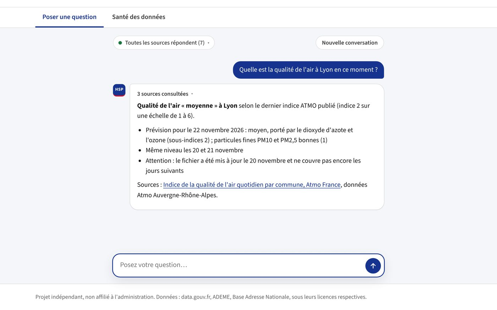
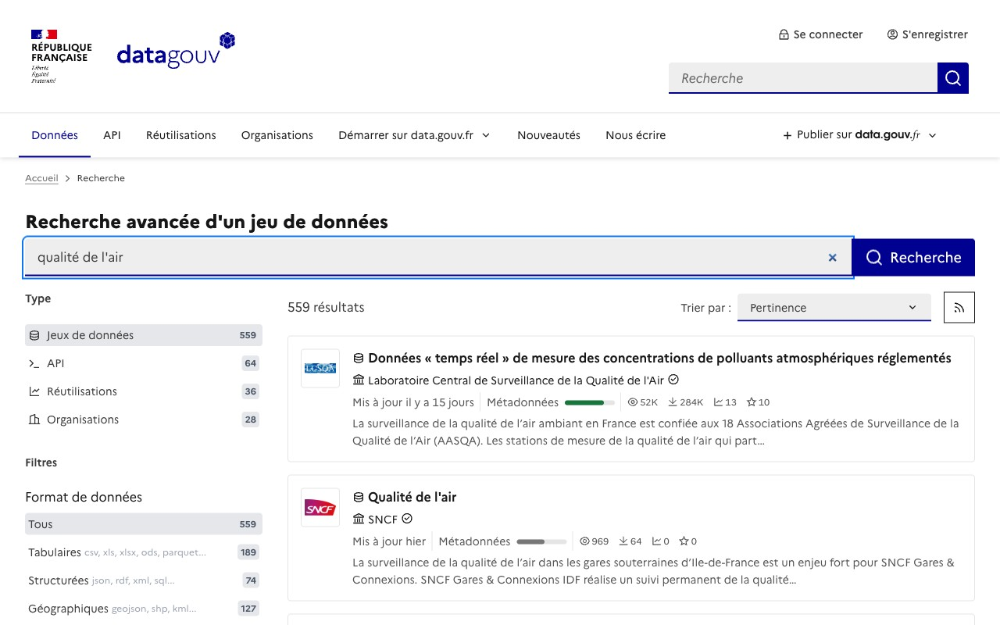
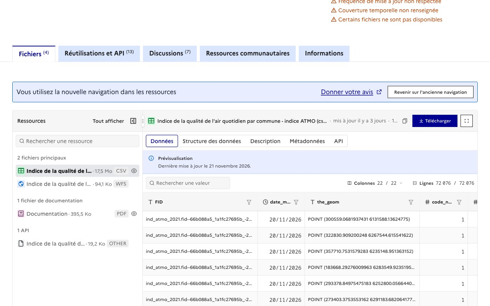
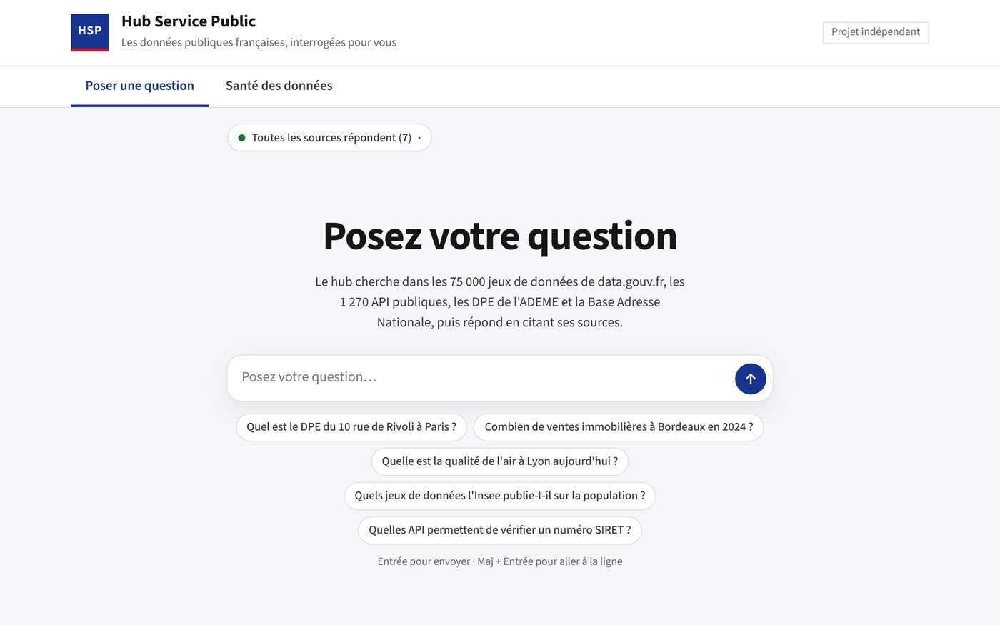
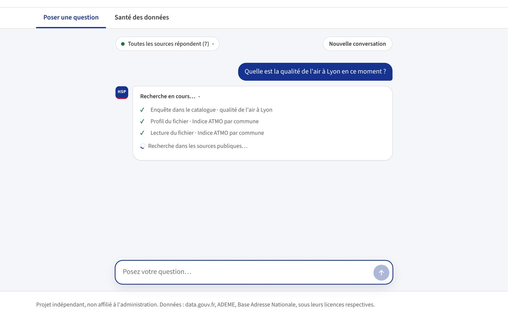
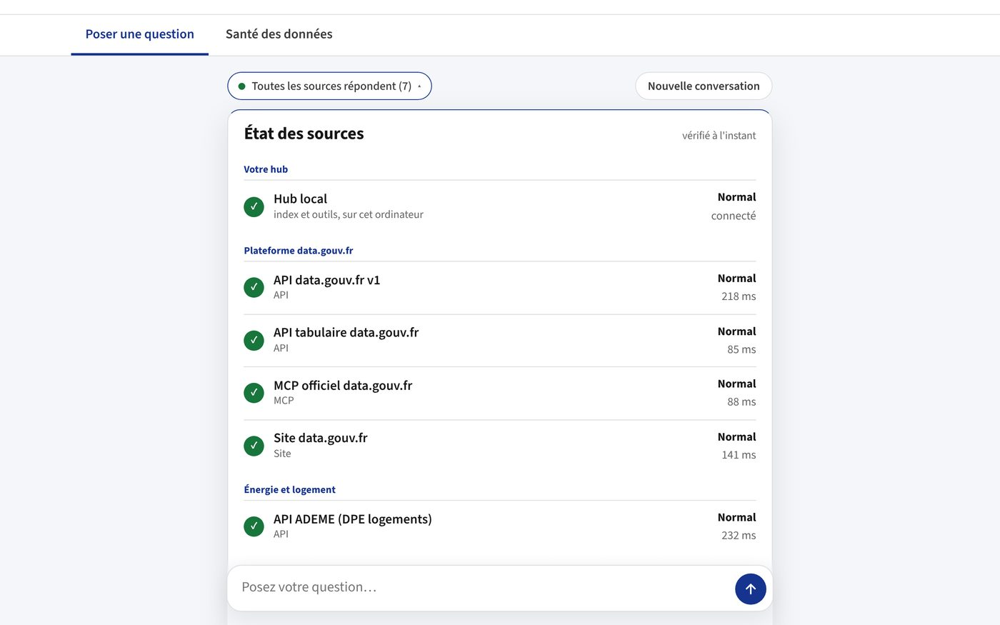
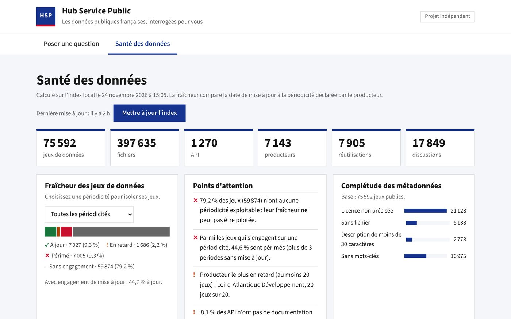

# Hub Service Public

Une page web où vous posez une question en français : le hub va chercher la réponse dans les données publiques françaises et cite ses sources.

« Quel est le DPE du 10 rue de Rivoli à Paris ? », « Quelle est la qualité de l'air à Lyon cette semaine ? », « Quelle API publique permet de vérifier un SIRET ? ». Au lieu de fouiller data.gouv.fr, de télécharger des CSV de plusieurs gigaoctets et de lire des documentations d'API, vous posez la question et vous obtenez la réponse avec le nom du jeu de données, son producteur et sa date. Un second onglet montre la santé des données et l'état de chaque source.

Le hub tourne sur votre machine, en lecture seule. Il fonctionne sans compte ni clé. Avec une clé d'API Anthropic (facultative), les réponses sont rédigées par Claude ; sans clé, la page présente les pistes sourcées trouvées par le hub.



*Une question, une réponse qui cite le jeu de données et son producteur. Illustration construite à partir des vraies données Atmo du 20 novembre 2026.*

## À quoi ça sert

data.gouv.fr publie environ 75 000 jeux de données et 1 270 API, venant de plus de 7 000 producteurs (Insee, ADEME, ministères, collectivités). Tout y est, mais rien n'est simple à trouver : une recherche renvoie des centaines de résultats, plus de 60 % des jeux n'indiquent pas leur fréquence de mise à jour, et lire un fichier suppose en général de le télécharger.

### Le problème, en images

Prenons une question simple : quelle est la qualité de l'air à Lyon en ce moment ?



*Sur data.gouv.fr, la recherche « qualité de l'air » renvoie 559 jeux de données, 64 API et 28 organisations. Lequel répond à la question ? Capture du site data.gouv.fr, 24 novembre 2026.*



*Une fois le bon jeu trouvé (l'indice ATMO quotidien d'Atmo France), il faut encore lire un fichier de 72 076 lignes, avec des codes (`code_qual`, `code_no2`...) et des coordonnées en Lambert 93, puis filtrer sur la bonne commune et la bonne date. Capture du site data.gouv.fr, 24 novembre 2026.*

Le hub fait ce travail à votre place : il trouve le bon jeu, lit les lignes de Lyon en direct, traduit les codes et vous répond en citant la source, comme dans l'image en haut de cette page. Il signale aussi les limites, ici un fichier qui n'a pas encore été mis à jour pour les derniers jours.

### Comment c'est construit

Le hub repose sur trois briques :

1. **Un index local du catalogue complet** (jeux, API, producteurs, réutilisations, discussions), interrogeable en quelques millisecondes, même hors ligne.
2. **Un accès en direct aux données** : lecture et filtrage des fichiers tabulaires sans téléchargement, appel des API ouvertes, DPE d'une adresse (ADEME et Base Adresse Nationale).
3. **Une page web locale** qui réunit les questions, la santé des données (fraîcheur, complétude, documentation des API) et l'état de chaque source, classées par catégorie. Elle s'ouvre d'un double-clic.

Le même hub se branche aussi sur l'application Claude ou sur Claude Code (serveur MCP), pour poser les questions directement dans une conversation.

Usages typiques : vérifier une donnée avant une décision, préparer une étude locale (immobilier, qualité de l'air, population), repérer l'API publique qui répond à un besoin, auditer la qualité d'un catalogue de données.

## Ce dont vous avez besoin

- macOS ou Linux. Sous Windows, suivez l'installation manuelle.
- [uv](https://docs.astral.sh/uv/), le gestionnaire Python. Le script d'installation propose de l'installer.
- Un navigateur web.
- Facultatif : une clé d'API Anthropic pour des réponses rédigées, ou l'application [Claude](https://claude.ai/download) pour poser les questions dans une conversation.
- Environ 700 Mo d'espace disque pour l'index, et une connexion internet.

## Installation

Récupérez d'abord le projet :

```bash
git clone https://github.com/stackwright-lab/hub-service-public.git
```

ou téléchargez l'archive (bouton « Code » puis « Download ZIP » sur GitHub) et décompressez-la. Ensuite :

### Méthode rapide (macOS, Linux)

```bash
cd hub-service-public
./install.sh
```

Le script vérifie uv, installe les dépendances, lance les tests, propose la première synchronisation du catalogue (30 à 60 minutes) et, si l'application Claude est installée, y branche le hub. Il demande confirmation à chaque étape et sauvegarde votre configuration Claude avant d'y toucher (fichier `.avant-hub`). Quittez l'application Claude avant de lancer le script, rouvrez-la à la fin.

`./install.sh --oui` accepte toutes les étapes sans poser de question.

### Méthode manuelle (toutes plateformes)

```bash
cd hub-service-public
uv sync --extra dev
uv run pytest
uv run hub-harvest --max-pages 2
uv run hub-harvest
```

L'avant-dernière commande est un essai d'une minute : elle doit finir par une ligne `Index : {...}` avec des nombres non nuls. La dernière synchronise tout le catalogue.

Facultatif, pour utiliser le hub dans l'application Claude : ouvrez Paramètres > Application de bureau > Serveurs MCP locaux > Modifier la configuration, et ajoutez dans `mcpServers` :

```json
"hub-service-public": {
  "command": "/chemin/absolu/vers/uv",
  "args": ["--directory", "/chemin/absolu/vers/hub-service-public", "run", "hub-server"]
}
```

`which uv` (macOS, Linux) ou `where uv` (Windows) donne le chemin de uv. Quittez puis rouvrez l'application : le serveur doit apparaître avec l'état « En cours ».

Pour Claude Code :

```bash
claude mcp add hub-service-public -- uv --directory /chemin/absolu/vers/hub-service-public run hub-server
```

### Paquet compilé

`uv build` produit une roue Python (`.whl`) et une archive source dans `dist/`, pour intégrer le hub dans un autre projet. Pour un usage normal, gardez le dossier du projet : l'index, la configuration et la page web y sont rangés.

## Guide d'utilisation

### 1. Ouvrir la page web (le plus simple)

Double-cliquez sur le fichier de lancement, dans le dossier du projet :

- macOS : `Lancer Hub Service Public.command` (la première fois : clic droit > Ouvrir, puis Ouvrir, pour passer l'avertissement de macOS) ;
- Windows : `Lancer Hub Service Public.bat` ;
- Linux : `./lancer-hub.sh`.

Ou, dans un terminal ouvert dans le dossier : `uv run hub-web`.

Une fenêtre de terminal s'ouvre et votre navigateur affiche la page à l'adresse `http://127.0.0.1:8765/`.

Laissez la fenêtre du terminal ouverte tant que vous utilisez la page ; fermez-la (ou Ctrl+C) pour arrêter. La page n'est accessible que depuis votre ordinateur.



**Onglet « Poser une question ».** Tapez votre question puis appuyez sur Entrée (ou sur la flèche), ou cliquez sur un exemple. Maj + Entrée passe à la ligne.

Votre question s'affiche à droite, la réponse juste en dessous. Pendant la recherche, chaque source interrogée apparaît en direct, avec une coche quand elle a répondu :



Quand la réponse arrive, cette liste se replie en « 3 sources consultées » (cliquez pour la revoir). Le champ de saisie reste en bas de l'écran pour enchaîner les questions de suivi ; « Nouvelle conversation » repart de zéro.

**État des sources.** La pastille en haut à gauche résume la situation : vert si tout répond, orange si une source est lente (plus de 1,5 seconde), rouge si une source est interrompue. Cliquez dessus pour voir le détail par catégorie (votre hub, plateforme data.gouv.fr, énergie et logement, adresses et géographie, catalogue des API publiques), avec le temps de réponse de chacune. Le contrôle se refait toutes les 3 minutes, ou avec « Revérifier ».



**Onglet « Santé des données ».** Les chiffres clés du catalogue, la fraîcheur des jeux (filtrable par périodicité), les points d'attention, la complétude des métadonnées, les formats, l'accès et la documentation des API, les producteurs en retard et les jeux en retard les plus consultés (filtrables). Le bouton « Mettre à jour l'index » lance la synchronisation incrémentale et un contrôle d'API, sans passer par le terminal.



*Chiffres réels de l'index au 24 novembre 2026 : près de 8 jeux sur 10 ne déclarent aucune fréquence de mise à jour exploitable.*

**Fenêtre étroite.** La page s'adapte à toutes les largeurs, par exemple une fenêtre de navigateur placée à côté d'un document. Elle n'est accessible que depuis l'ordinateur qui fait tourner le hub, pas depuis un téléphone.


**Deux modes de réponse.**

- Sans clé (par défaut) : la page présente ce que le hub a trouvé. Pour un DPE d'adresse, le diagnostic complet ; pour les autres questions, les jeux de données pertinents, un extrait des lignes filtrées sur le lieu cité, les API utiles et les liens vers data.gouv.fr.
- Avec une clé d'API Anthropic : Claude enchaîne les outils du hub (recherche, lecture des fichiers, appels d'API, calculs) et rédige une réponse sourcée. La colonne « Sources consultées » liste chaque appel. Pour l'activer, copiez `.env.example` en `.env` et renseignez `ANTHROPIC_API_KEY=` avec une clé créée sur console.anthropic.com, puis relancez la page. L'usage de l'API est facturé par Anthropic, à part de tout abonnement Claude ; la clé reste sur votre ordinateur et n'est envoyée qu'à api.anthropic.com.

### 2. Poser une question dans l'application Claude

Si vous avez branché le hub sur l'application Claude ou sur Claude Code, ouvrez une conversation et posez votre question normalement :

- « Quel est le DPE du 10 rue de Rivoli à Paris ? » Claude géocode l'adresse et lit le diagnostic ADEME : étiquettes énergie et climat, date, validité, surface, consommation, coût annuel estimé.
- « Quelle est la qualité de l'air à Lyon cette semaine ? » Il trouve l'indice ATMO quotidien d'Atmo France et filtre sur la commune.
- « Quels jeux l'Insee publie-t-il sur la population des communes ? »
- « Trouve une API publique pour vérifier un numéro SIRET et teste-la sur le mien : … »

Claude cite le jeu, le producteur et la date. S'il ne trouve rien de fiable, il doit le dire plutôt qu'inventer. Pour un chiffre précis (un total, une moyenne), demandez-le explicitement : il interroge alors le fichier avec des regroupements au lieu de lire les premières lignes.

### 3. La page dans l'application Claude

La même page peut s'ouvrir dans l'application Claude pour Mac ou Windows, sans clé d'API : Claude y rédige les réponses avec votre abonnement. Dans une conversation de l'application de bureau, joignez `interface/index.html` et demandez : « Publie ce fichier comme artefact, avec les capacités sample et mcp sur le serveur host:hub-service-public ». Ouvrez l'artefact dans l'application et acceptez les autorisations demandées au premier usage. Cette version ne fonctionne que dans l'application de bureau, sur la machine où tourne le hub.

### 4. L'ancien tableau de bord (facultatif)

```bash
uv run hub-dashboard --serve
```

Version précédente, sans assistant, conservée pour la recherche avancée dans le catalogue (filtres, aperçu paginé des fichiers). Elle utilise le même port que la page web : n'ouvrez pas les deux en même temps, ou ajoutez `--port 8766`.

- **Recherche** : tout le catalogue, avec filtres par producteur, format et fichiers interrogeables, la fiche de chaque jeu et un aperçu en direct des lignes d'un fichier, filtrable par colonne. Une question de DPE d'adresse y est reconnue. Les autres questions donnent un dossier de pistes sourcées, pas une réponse rédigée : il n'y a pas de modèle de langage dans le navigateur.
- **Vue d'ensemble, Jeux de données, API, Écosystème** : fraîcheur des jeux comparée à leur périodicité déclarée, complétude des métadonnées, documentation et joignabilité des API, discussions restées sans réponse.
- **Services** : disponibilité en direct de l'API data.gouv.fr, de l'API tabulaire, du MCP officiel, de l'ADEME et du géocodeur.
- **Mettre à jour** : synchronisation incrémentale, contrôle d'un échantillon d'API et des services, puis rechargement.

`uv run hub-dashboard` seul écrit une version statique dans `data/dashboard.html`, sans appel réseau.

### 5. Garder l'index à jour

```bash
uv run hub-harvest --incremental
```

Une fois par semaine : récupère en quelques minutes les jeux modifiés depuis le dernier passage. Une fois par mois, relancez `uv run hub-harvest` en entier, car l'incrémental ne voit ni les suppressions ni certaines modifications de métadonnées. Le bouton « Mettre à jour l'index » de l'onglet Santé des données le fait pour vous.

En cas d'interruption : `uv run hub-harvest --resume`. Si quelques pages ont échoué : `uv run hub-harvest --fill-gaps`, qui ne télécharge que ce qui manque.

### 6. Mesurer la santé des API

```bash
uv run hub-health --sample 300
```

Teste un échantillon d'API du catalogue : joignabilité, documentation OpenAPI, latence. `--all` les teste toutes. Les résultats alimentent le tableau de bord et `data/health_report.csv`.

## Les outils mis à disposition de Claude

Tous en lecture seule, sauf `synchroniser_index`.

| Outil | Rôle |
|---|---|
| `repondre` | Point d'entrée d'une question libre : recherche, puis lecture en direct des fichiers les plus pertinents, filtrés sur le lieu cité |
| `dpe_par_adresse` | DPE d'une adresse précise (ADEME, logements existants depuis juillet 2021) |
| `rechercher` | Recherche plein texte sur les jeux, API, producteurs, réutilisations et discussions, avec filtres |
| `fiche_jeu_de_donnees`, `fiche_api`, `fiche_organisation` | Détail d'un élément du catalogue |
| `profil_fichier` | Colonnes et valeurs fréquentes d'un fichier tabulaire |
| `interroger_fichier` | Filtrer, trier, regrouper et compter les lignes d'un fichier sans le télécharger |
| `documentation_api`, `appeler_api` | Lire l'OpenAPI d'une API du catalogue, puis l'appeler en GET |
| `disponibilite_sources` | État en direct des sources, fraîcheur de l'index, santé des API |
| `sante_des_donnees` | Indicateurs de santé du catalogue (fraîcheur, complétude, API, écosystème) |
| `synchroniser_index` | Met à jour l'index local en arrière-plan (seul outil qui écrit, uniquement dans l'index) |
| `etat_du_hub` | Taille et dernières synchronisations de l'index |

## Limites à connaître

- **Le hub ne sait que ce que publient data.gouv.fr, l'ADEME et la Base Adresse Nationale.** Vos impôts, votre dossier CAF ou votre carte grise n'y sont pas : ces données relèvent d'accès restreints.
- **Trois types d'API.** Environ 87 % sont ouvertes et appelées directement. Environ 3,5 % demandent un compte : déclarez votre clé dans `config/api_keys.yaml` (modèle fourni). Environ 9 % sont réservées aux administrations et ne sont jamais appelées.
- **Fraîcheur.** Un jeu ancien n'est pas une donnée actuelle. Vérifiez la date que Claude cite.
- **DPE.** Seuls les logements existants diagnostiqués depuis juillet 2021 sont couverts, avec un diagnostic par logement. Une absence de résultat ne prouve pas l'absence de DPE.
- **Recherche par mots-clés.** Les pistes de `repondre` peuvent contenir un jeu hors sujet. Claude doit le repérer, vous aussi.
- **Fichiers lisibles en direct.** Seuls ceux analysés par data.gouv.fr, soit environ un fichier sur six (surtout CSV et XLSX). Les opérateurs `exact`, `differs`, `contains`, `in` et `isnull` ont été vérifiés ; `less`, `greater` et leurs variantes strictes sont acceptés mais pas encore testés.

## Sécurité et vie privée

- Requêtes GET uniquement vers les sources ; le seul outil qui écrit met à jour votre index local.
- La page web n'écoute que sur `127.0.0.1`, refuse les autres noms d'hôte, exige un jeton tiré à chaque lancement et n'expose qu'une liste fermée d'outils.
- Les adresses d'API viennent de tiers : tout hôte non public (localhost, réseau local, métadonnées cloud) est refusé, redirections comprises, et chaque appel reste verrouillé sur l'hôte déclaré. Limite connue : un changement de DNS entre la vérification et la connexion (DNS rebinding) n'est pas couvert.
- Les clés d'API restent dans votre environnement. Elles ne sont jamais renvoyées au modèle ni envoyées en `http`, et git les ignore.
- Toute réponse d'API ou de fichier est signalée à Claude comme une donnée tierce, jamais comme une instruction.
- L'index ne conserve pas les noms de personnes physiques. Le jeu DPE de l'ADEME ne contient aucun nom d'occupant ou de propriétaire.

## Dépannage

| Symptôme | Cause probable et remède |
|---|---|
| La page ne s'ouvre pas au double-clic (macOS) | Clic droit sur `Lancer Hub Service Public.command` > Ouvrir > Ouvrir. Si uv est introuvable, lancez d'abord `./install.sh`. |
| « La page ne joint plus le hub » | La fenêtre du terminal a été fermée : relancez le fichier de lancement et rechargez la page. |
| « Port déjà utilisé » | La page tourne déjà : ouvrez `http://127.0.0.1:8765/`, ou lancez `uv run hub-web --port 8766`. |
| Réponses « mode sans IA » alors qu'une clé est renseignée | Le fichier s'appelle bien `.env` (avec le point) et contient `ANTHROPIC_API_KEY=...` sans espace ; relancez la page. |
| Le hub n'apparaît pas dans Claude | Quittez l'application avec Cmd+Q, pas seulement la fenêtre, puis rouvrez-la. Vérifiez le chemin absolu de uv dans la configuration. |
| État « Échec » dans les paramètres de Claude | Bouton « Afficher les journaux ». Le plus souvent : uv introuvable, ou dossier déplacé après l'installation. |
| « Index absent » | La synchronisation n'a pas été faite : `uv run hub-harvest`. |
| `quote>` dans le Terminal | Une commande copiée avec un commentaire ou une apostrophe. Ctrl+C, puis recopiez la commande seule. |
| Une source en « Interrompu » | Panne côté producteur. Le reste du hub continue de fonctionner. |

## Pour les développeurs

```bash
uv sync --extra dev
uv run pytest
uv build
```

`uv build` produit la roue et l'archive source dans `dist/`. La CI GitHub Actions lance les tests sur Python 3.10 et 3.12 à chaque push.

```
src/hub_service_public/
  harvest.py      synchronisation (complète, incrémentale, reprise, comblement, purge)
  db.py           schéma SQLite et recherche plein texte
  normalize.py    JSON data.gouv.fr vers index
  search.py       recherche et fiches
  live.py         fichiers tabulaires et appels d'API sous contrôle
  net.py          client HTTP (nouvelles tentatives, garde anti-SSRF)
  server.py       serveur MCP
  answer.py       enquête pour une question libre
  dpe.py          DPE d'une adresse
  health.py       santé des API du catalogue
  services.py     santé des services (config/services.yaml)
  dashboard*.py   tableau de bord et serveur local
  explorer.py     routes JSON de la recherche
  web.py          page web locale (outils du hub, réponses rédigées via l'API Anthropic)
  livefeed.py     chiffres en direct du site
interface/        page web (index.html) et son adaptateur local (local.js)
tests/            tests hors ligne
```

Le hub complète le MCP officiel de data.gouv.fr (`https://mcp.data.gouv.fr/mcp`), qui peut être branché à côté (`config/claude_mcp_config.example.json`). Projet indépendant, sans lien avec Etalab, l'ADEME ou l'IGN.

## Licence

Copyright (c) 2026 QXScale. Code distribué sous la **Licence publique de l'Union européenne (EUPL) v. 1.2** (voir `LICENSE` et `NOTICE`).

En pratique : vous pouvez installer, utiliser, étudier, modifier et redistribuer ce logiciel, y compris dans un cadre professionnel. Si vous diffusez une version modifiée, ou si vous la proposez à d'autres comme service en ligne, vous devez publier son code source sous la même licence et conserver la mention de copyright. Le logiciel est fourni sans garantie. Ce résumé ne remplace pas le texte de la licence.

Le nom « Hub Service Public » et le logo HSP ne sont pas couverts par cette licence. Les données restent soumises aux licences de leurs producteurs ; le dépôt ne contient aucune donnée synchronisée.
